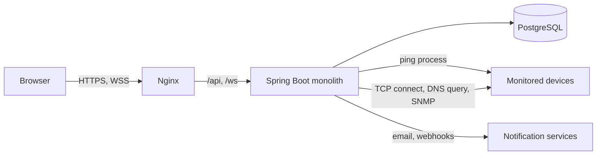

# NetPulse

Real-time network monitoring: ICMP, TCP, DNS and SNMP with live status, network engineering tools, alerting and a NOC-style interface.


NetPulse measures real networks. Status comes from real `ping` processes, TCP handshakes and DNS queries. Synthetic data exists only in the separate, permanently labelled demo stack.

## Features

### Core monitoring

- **Device inventory** with validation of IPv4, IPv6 and hostnames, tags, per-device intervals, bulk actions and server-side search, filter, sort and paging
- **ICMP monitoring** through the OS `ping`, with per-OS parsers (Linux, macOS, Windows): RTT min/avg/max, packet loss, jitter, and categorized errors
- **TCP port checks** classified as `OPEN`, `CLOSED` or `FILTERED_OR_UNKNOWN`
- **DNS checks** for A, AAAA, MX, NS, TXT and PTR against any server, keeping NXDOMAIN, SERVFAIL, NODATA and timeouts distinct
- **Status logic that avoids false alarms:** an ICMP failure alone never means DOWN, and configurable thresholds prevent flapping
- **Live dashboard** over authenticated WebSockets, with latency trends and a 24h uptime bar
- **Hourly rollups and retention** (7 days raw, 90 days rolled up)
- **Security:** short-lived JWT, rotating hashed refresh tokens with reuse detection, CSRF protection, login lockout and rate limiting, and a DNS-rebinding guard

### Network engineering tools

- **Traceroute** with hops streamed live, a path view, and per-OS parsers
- **Subnet calculator:** CIDR breakdown, binary view, /31 and /32 handling, and a VLSM planner
- **LAN discovery:** bounded ping sweep, ARP table, offline MAC vendor lookup, reverse DNS and one-click monitoring, restricted to authorized ranges
- **SNMP v2c and v3 authPriv:** system info, interface state and bandwidth from counter deltas, with 32-bit wrap and reboot handling. Credentials are AES-GCM encrypted

### Alerting and administration

- **Alert rules** for device down, RTT, packet loss, closed ports, interface down and utilization, with severities and "for X minutes"
- **Triggered, acknowledged, resolved lifecycle**, with notifications only on a state change, and maintenance windows
- **Notifications** in the app, by email, and by Slack, Discord or Telegram webhook, with retries and backoff
- **Admin, Operator and Viewer roles**, an audit log, a filterable event log, and uptime/SLA reports, both with CSV export


## Quick start

**Demo (synthetic data, no configuration):**

```bash
docker compose -f docker-compose.demo.yml up --build
```

Open <http://localhost:8089> and sign in with `demo` / `NetPulse-Demo-2026!`.

**Real monitoring:**

```bash
cp .env.example .env     # then set every value; use COOKIE_SECURE=false for plain http on localhost
docker compose up --build
```

Open <http://localhost:8088>.

**Development with hot reload:**

```bash
docker compose -f docker-compose.dev.yml up -d
cd backend  && ./mvnw spring-boot:run     # dev login: admin / NetPulse-Dev-2026!
cd frontend && npm install && npm run dev  # http://localhost:5173
```

Build with JDK 21 to 25. If your default JDK is newer (Homebrew's Maven can pick up a newer one), set `JAVA_HOME` first, because JaCoCo doesn't support later class-file versions yet.

## Architecture



A modular monolith with no microservices or message broker. See [docs/ARCHITECTURE.md](docs/ARCHITECTURE.md).

**Stack:** Java 21, Spring Boot 3.5, PostgreSQL 16, Flyway, dnsjava, SNMP4J, MapStruct, React 18, TypeScript, Vite, Tailwind, shadcn/ui, TanStack Query, Recharts, Docker, Nginx, GitHub Actions.

## Testing

```bash
cd backend  && ./mvnw verify      # unit + Testcontainers integration tests (Docker required)
cd frontend && npm test           # component and validation tests
cd frontend && E2E_PASS=<admin password> npm run e2e   # against a running stack with ALLOW_LOCAL_TARGETS=true
```

## Try it by hand

1. Add `8.8.8.8` with TCP port `443`. It should turn **Up** without reloading the page.
2. Add a TCP port nothing listens on, such as `81`. The device shows **Degraded**, and the Ports tab explains why.
3. Add `192.0.2.1`, a reserved address that never answers. It stays **Unknown**, then turns **Down** after 3 failed cycles.
4. Compare the numbers with `ping -c 4 8.8.8.8` and `dig @8.8.8.8 example.com`.
5. In **Traceroute**, trace `8.8.8.8` and compare with `traceroute -n 8.8.8.8`.
6. In **Subnet Calculator**, try `10.1.1.1/31`, then allocate a VLSM plan.
7. In **Discovery**, scan your own /24 with the backend running natively, then compare with `arp -an`.
8. In **Alerts → Rules**, add a Port closed rule with duration 0, then add a device with a closed port. The bell updates by itself. Acknowledge the alert.
9. For SNMP and failure experiments, follow [docs/LAB_SETUP.md](docs/LAB_SETUP.md).

Set `CREDENTIAL_ENCRYPTION_KEY` before saving SNMP credentials or webhooks. The dev profile has a development key built in.

Note: on macOS and Windows, Docker runs in a VM. Latency from the containerized backend includes that VM's NAT, and only the native backend can see your LAN directly.

## Learning docs

[ICMP and ping](docs/learning/icmp-ping.md) · [TCP ports](docs/learning/tcp-ports.md) · [DNS](docs/learning/dns.md) · [Device status](docs/learning/device-status.md) · [Traceroute](docs/learning/traceroute.md) · [Subnetting](docs/learning/subnetting.md) · [ARP and discovery](docs/learning/arp-discovery.md) · [SNMP](docs/learning/snmp.md) · [Alerting](docs/learning/alerting.md)

Deploying: [docs/DEPLOYMENT.md](docs/DEPLOYMENT.md) · Lab: [docs/LAB_SETUP.md](docs/LAB_SETUP.md)
