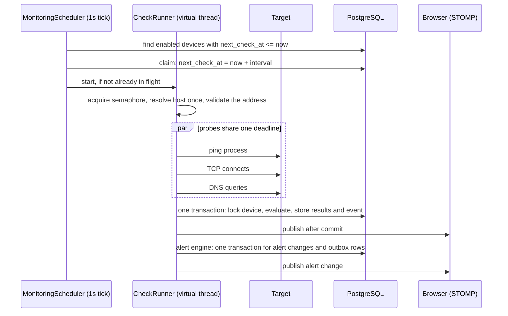
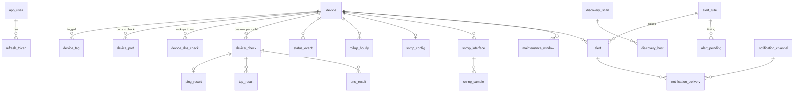

# Architecture

NetPulse is a modular monolith: one deployable Spring Boot application, organized by feature. At this scale, microservices would add network failure modes and operational cost with no benefit.

## Modules

| Package | Responsibility |
|---|---|
| `common` | Errors (RFC 7807), `TargetValidator`, `ProcessRunner`, configuration |
| `auth`, `user` | Login, JWT, refresh rotation, lockout; users and first-admin bootstrap |
| `device` | Inventory CRUD, validation, search |
| `monitoring.engine` | Scheduler, concurrency limits, one check cycle |
| `monitoring.ping` / `tcp` / `dns` | The probes |
| `monitoring.status` | Pure status logic |
| `monitoring.result` | Time-series storage and queries |
| `monitoring.retention` | Hourly rollups and cleanup |
| `traceroute`, `subnet`, `discovery`, `snmp` | Network tools and SNMP polling |
| `alert`, `notification` | Rules, state machine, maintenance windows, outbox delivery |
| `report`, `event`, `audit`, `settings` | SLA reports, event log, audit trail, runtime settings |
| `dashboard`, `realtime`, `system`, `demo` | KPIs, STOMP push, public info, synthetic seed |

## Data flow of a check

SNMP polls follow the same dispatch design and feed the same alert engine. A separate worker delivers the outbox rows to email and webhooks, retrying with backoff.

## Database

The [migrations](../backend/src/main/resources/db/migration/) are the full definition.

## Key decisions

| Decision | Reason |
|---|---|
| Polling tick on `next_check_at`, not one timer per device | Survives restarts; interval changes and "check now" are single column updates |
| Virtual threads plus a semaphore | Threads are cheap but each cycle starts a process, so concurrency still needs a limit |
| In-flight set | A slow device is skipped, never checked twice at once |
| No DB transaction during network I/O | A slow host must never hold a pooled connection or row lock |
| `device_check` parent row per cycle | Uptime depends on the combined result; ping alone would count ICMP-blocked hosts as down |
| JDBC for time-series, JPA for inventory | Append-only rows gain nothing from entity tracking; CRUD does |
| Engine updates device state with SQL | Monitoring writes don't conflict with the optimistic lock on user edits |
| Idempotent upsert rollups | The open hour can be recomputed, and a crash needs no cleanup |
| Resolve once per cycle, connect to that address | Closes the DNS-rebinding window |
| Monitor faults yield `UNKNOWN` | A broken monitor must not report the whole network as down |
| JWT in memory, refresh in `HttpOnly` cookie | XSS can't read the long-lived credential; only cookie endpoints need CSRF defense |
| No CSRF rotation on authentication | With stateless JWT, every request "authenticates", so rotation would break concurrent refreshes |
| No Lombok | Explicit code avoids coupling the build to compiler internals across JDK versions |
| Transactional outbox for notifications | An alert and its messages commit together, and a slow SMTP server holds no database connection |
| `NO_DATA` is separate from "clear" | An unreachable host has no RTT, which must not resolve a latency alert |
| Partial unique index on open alerts | The database guarantees one open alert per condition |
| Rates from `sysUpTime`, samples dropped on doubt | The agent's clock is the accurate one, and a gap is more honest than a false spike |
| Traceroute runs held in memory | They're short-lived, and the audit log keeps the record of who ran what |
| AES-GCM with the owner id as associated data | Tampering is detected, and ciphertext can't be copied to another row |
| Webhook redirects disabled, loopback refused | An admin-supplied URL can't be used to reach the server's own internal services |

## Privileges and platforms

| Concern | Detail |
|---|---|
| Linux containers | Run as non-root with `cap_drop: ALL` and `cap_add: NET_RAW`, the minimum for ICMP |
| macOS | `ping` is privileged already; `ping6` handles IPv6 and uses a different output format |
| Windows | Output is localized, so the parser matches structure. Fixtures are written from the documented format and have **not** been verified on a live Windows machine |
| Docker Desktop | Containers run in a VM and can't see your LAN's ARP table. Discovery needs the native backend, or `network_mode: host` on Linux |

## Current limits

- Thresholds are global, not per device.
- Rate limiting, the STOMP broker and the settings cache are in-memory, so the backend runs as a single instance.
- The subnet calculator and discovery handle IPv4 only.
- Every API request re-checks the account, so deleting or disabling a user, changing their role, or resetting their password takes effect immediately. Open WebSockets are re-checked every 5 seconds and closed when their token expires or the account loses access. Logging out revokes the refresh token; the in-memory access token is discarded by the browser.
- Webhook destinations are checked before each send, but the HTTP client resolves the name again, leaving a small DNS-rebinding window. Only admins can configure webhooks.
- SNMP traps are not received; everything is polled.
- The Linux traceroute and neighbor formats were checked against real tool output. The Windows `tracert` and `arp -a` fixtures are written from the documented format and have **not** been run on a Windows machine.
