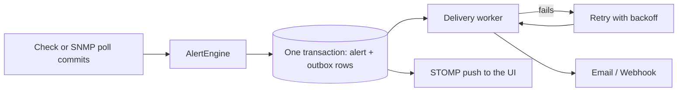

# Alerting, notifications and SLA

## 1. The concept

Monitoring records what happened. Alerting decides when a person should be interrupted. A good alert fires once for one real problem, and says when the problem is over.

## 2. Layers

This is application logic over measurements from every layer: ICMP (3), TCP (4), DNS and SNMP (7). Webhooks use HTTPS and email uses SMTP on port 587 with STARTTLS.

## 3. The model

```
           held for the rule's duration              operator
 (normal) -----------------------------> TRIGGERED -----------> ACKNOWLEDGED
                                             |                       |
                                             +---- condition clears -+--> RESOLVED
```

| Design rule | Why |
|---|---|
| Notify only on a state change | A 3-hour outage is one message, not 180 |
| "For X minutes" | A brief spike doesn't page anyone |
| No data is not recovery | With no ping replies there is no RTT, but latency hasn't improved |
| Admin-down isn't a fault | Someone shut that interface on purpose |
| Maintenance windows | Planned work raises no alerts and doesn't count against the SLA |

## 4. Flow



## 5. The Java implementation

- `AlertDecider` is the state machine, and `RuleEvaluator` compares rules with facts. Neither does I/O, so every path is unit tested.
- A partial unique index allows one open alert per rule, device and subject, so the database enforces it however evaluations interleave.
- `alert_pending` stores when a breach began, so a restart doesn't reset "for X minutes".
- **Transactional outbox:** notifications are rows committed together with the alert change, then delivered by a worker. A crash can't lose a message or send one for a change that rolled back.
- The worker claims rows with `FOR UPDATE SKIP LOCKED`, and retries at 30s, 1m, 2m and so on, capped at an hour, for 6 attempts.
- **SLA:** uptime = (UP + DEGRADED cycles) / (UP + DEGRADED + DOWN cycles). Paused, UNKNOWN and maintenance time are excluded.

## 6. Verify it yourself

```bash
# On a throwaway Linux host: add latency, then watch an RTT rule fire
sudo tc qdisc add dev eth0 root netem delay 300ms
sudo tc qdisc del dev eth0 root

# See what a webhook sends
nc -l 9000
```

Add a TCP port nothing listens on, and a "Port closed" rule with a duration of 0. In Wireshark, `tcp.flags.reset == 1` shows the refusal behind the alert. Point a channel at a test URL and use **Send test**: it reports the real result.

## 7. Troubleshooting

| Symptom | Likely cause |
|---|---|
| No alert | Rule disabled, duration not yet elapsed, or a maintenance window |
| Alert raised but no email | `SMTP_HOST` unset. See Settings → Recent deliveries |
| Webhook "not an allowed destination" | The host is loopback or link-local |
| SNMP rules never fire | SNMP isn't configured, or polls are failing |
| Too many alerts | Lengthen the duration, or scope the rule to fewer devices |

## 8. Interview questions

1. **How do you prevent alert fatigue?** Notify on state changes only, require a sustained duration, and use severities and maintenance windows.
2. **What's the difference between acknowledged and resolved?** Acknowledged means a person owns it. Resolved means the condition has actually cleared.
3. **What is the outbox pattern?** Writing outgoing messages in the same transaction as the business change, then delivering them separately. It prevents lost or phantom messages.
4. **Why use exponential backoff?** It stops a failing endpoint from being hammered and gives it time to recover.
5. **What does 99.9% uptime allow per month?** About 43 minutes.
6. **Why exclude maintenance from an SLA?** Planned, agreed downtime isn't a failure of the service commitment.
7. **What does `SKIP LOCKED` do?** Lets workers take different rows without waiting for or duplicating each other.
