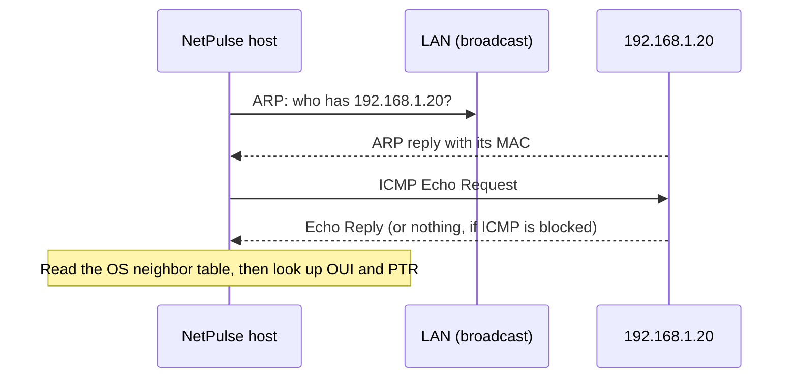

# ARP and LAN discovery

## 1. The concept

IP addresses route packets between networks, but on a local link frames are delivered by MAC address. ARP maps one to the other. Discovery combines a ping sweep with the resulting ARP table to find what is on a LAN.

## 2. Layers

ARP sits between OSI layers 2 and 3. It is carried directly in Ethernet (EtherType `0x0806`), not in IP, so **it can't cross a router**. Ping is ICMP at layer 3. Reverse DNS is at layer 7.

## 3. The protocol

- **ARP Request**, broadcast to `FF:FF:FF:FF:FF:FF`: "Who has 192.168.1.1? Tell 192.168.1.50."
- **ARP Reply**, unicast: "192.168.1.1 is at aa:bb:cc:dd:ee:ff."

The OS caches the answer in its neighbor table. In a MAC address, the first 3 octets are the **OUI**, assigned to a manufacturer by the IEEE. Bit `0x02` of the first octet marks a locally administered address, which is what phones use for randomized private MACs. Those reveal no vendor.

## 4. Flow



The sweep's real value is the side effect. To send any packet to a local address, the OS must ARP for it first, so a host that **blocks ICMP** still shows up in the table. NetPulse lists those as "ARP only".

## 5. The Java implementation

- `ScanAuthorizer` rejects anything larger than /22 or outside the authorized ranges, by default loopback and RFC 1918.
- `DiscoveryService.sweep` runs one ping per address on virtual threads, limited by a semaphore and a maximum duration.
- `NeighborTableParser` has one pattern each for `ip neigh`, `arp -an` and `arp -a`. It normalizes macOS's unpadded octets and drops broadcast and multicast entries.
- `OuiDatabase` loads a bundled copy of the IEEE registry, trying 36-, 28- and 24-bit prefixes, longest first.
- Each scan writes its audit row in the same transaction as the scan row.

**Privileges:** Docker Desktop runs containers in a VM with its own neighbor table, so run the backend natively to scan your LAN on macOS or Windows.

## 6. Verify it yourself

```bash
ip neigh show                # Linux
arp -an                      # macOS
arp -a                       # Windows
sudo arping -c 3 192.168.1.1 # Linux; a layer 2 ping
```

Wireshark display filter: `arp`. To see one host's conversation: `eth.addr == aa:bb:cc:dd:ee:ff`.

## 7. Troubleshooting

| Symptom | Likely cause |
|---|---|
| Hosts have no MAC under Docker Desktop | The container sees only the VM's table |
| Your own machine has no MAC | A host doesn't ARP for itself |
| A device was just unplugged but still appears | Entries linger until they expire (`STALE`) |
| Two hosts alternate behind one IP | Duplicate address, or ARP spoofing |
| Fewer hosts than expected | Wi-Fi client isolation, a different VLAN, or sleeping devices |

## 8. Interview questions

1. **What does ARP do?** It resolves an IPv4 address to a MAC address on the local link.
2. **Is ARP a request broadcast or unicast?** The request is broadcast and the reply is normally unicast.
3. **Why can't you ARP for a host in another subnet?** ARP isn't routable. A host sends off-subnet traffic to its gateway's MAC instead.
4. **What is gratuitous ARP?** A host announcing its own mapping unprompted, used to detect duplicates and update caches after a failover.
5. **What is ARP spoofing, and what mitigates it?** ARP has no authentication, so an attacker can claim another IP. Dynamic ARP Inspection on switches defends against it.
6. **What replaces ARP in IPv6?** Neighbor Discovery, which uses ICMPv6 and multicast.
7. **Why might a live host not answer a ping sweep?** Its firewall drops ICMP. It must still answer ARP, so the neighbor table finds it.
