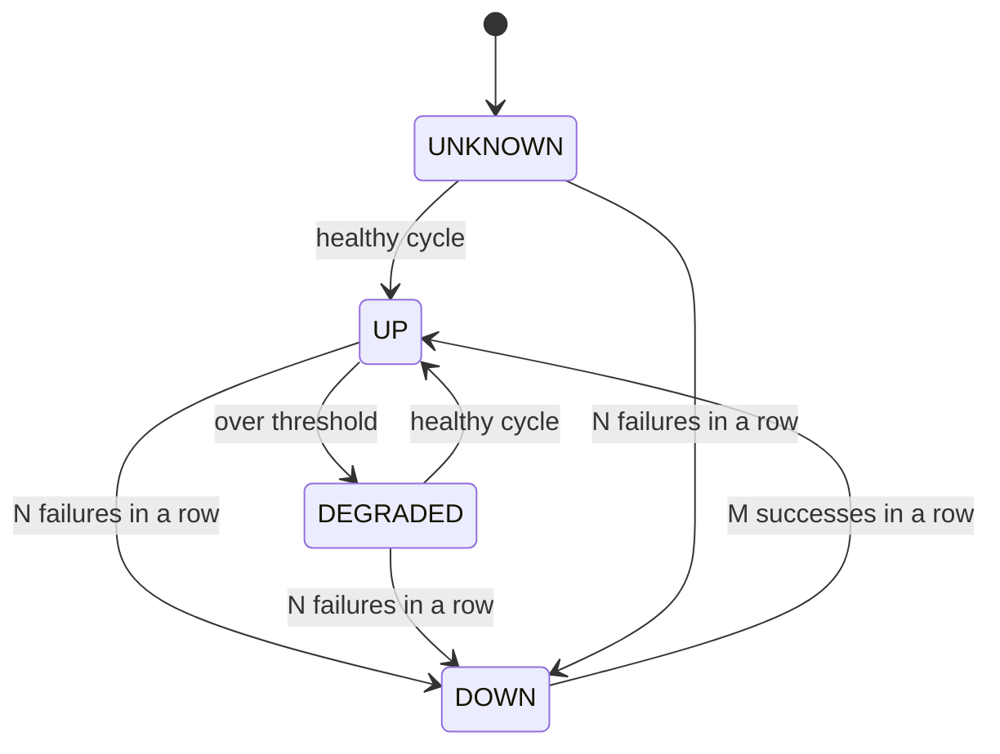

# Deciding whether a device is up

## 1. The concept
Monitoring tools get judged on false alarms. NetPulse combines all the evidence from a cycle, then requires that evidence to persist before it changes state.

| State | Meaning |
|---|---|
| `UP` | Reachable, every check healthy |
| `DEGRADED` | Reachable, but over a threshold or a configured check failed |
| `DOWN` | All configured checks failed, N cycles running |
| `UNKNOWN` | Not observed yet, or the monitor itself can't observe |
| `PAUSED` | Monitoring turned off by a user |

## 2. Layers
This logic combines evidence from several layers: ICMP (3), TCP (4) and DNS (7). The layers fail independently, which is exactly why combining them is more accurate than ping alone.

## 3. Evidence rules
A device is reachable if **any** of these hold: ping got a reply; a TCP handshake completed; a DNS server running on the device answered. If ping failed but TCP worked, it's reachable and flagged **ICMP blocked**.

A missing `ping` binary or a permission error is a fault in the *monitor*. It produces `UNKNOWN`, never `DOWN`.

## 4. Flow


## 5. The Java implementation
`StatusEvaluator` is pure: no I/O, no clock. `assess` turns one cycle's measurements into a verdict, and `next` applies the N and M counters. `CheckRecorder` runs it inside a transaction holding a `SELECT ... FOR UPDATE` on the device row, so a concurrent pause can't be overwritten by a stale result.

Defaults (see `application.yml`): DEGRADED above 150 ms or 10% loss; DOWN after 3 failures; back from DOWN after 2 successes.

## 6. Verify it yourself
Add a device, then on a Linux target:
```bash
sudo iptables -A INPUT -p icmp -j DROP     # expect ICMP blocked if a TCP port is configured
sudo tc qdisc add dev eth0 root netem delay 200ms   # expect DEGRADED
sudo tc qdisc del dev eth0 root            # back to UP
```
The device's History tab lists every status change and its reason.

## 7. Troubleshooting
| Symptom | Likely cause |
|---|---|
| Device stuck on `UNKNOWN` | Ping tool missing or lacks permission; read the Overview assessment |
| `DOWN`, yet the site loads in a browser | No TCP port configured and ICMP blocked; add port 443 |
| Permanently `DEGRADED` | A configured port is closed, or a threshold is too strict for a distant host |
| Slow to show `DOWN` | Intended: N × check interval |

## 8. Interview questions
1. **Why not alert on the first failed ping?** Single losses are common. Requiring consecutive failures trades a little detection time for far fewer false alarms.
2. **What is flapping?** A state that keeps oscillating around a failure boundary. Different N and M thresholds give hysteresis, which damps it.
3. **How long until a 60-second-interval device shows DOWN with N=3?** Up to about 3 intervals, so around 3 minutes.
4. **Why separate "the monitor failed" from "the target failed"?** Otherwise a broken monitoring host would report every device as down at once.
5. **How would you test this logic without a network?** It's a pure function, so unit tests can supply measurements directly and assert the result.
