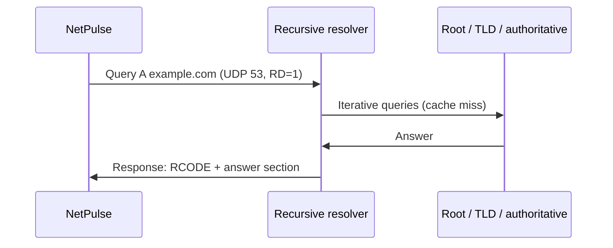

# DNS checks

## 1. The concept
DNS maps names to data. A site can be up and still unreachable to users if its DNS is broken, so NetPulse tests DNS separately from reachability.

| Record | Holds |
|---|---|
| A / AAAA | IPv4 / IPv6 address |
| MX | Mail servers, with priorities |
| NS | Authoritative name servers |
| TXT | Free text: SPF, domain verification |
| PTR | Reverse mapping from an IP to a name |

## 2. Layers
DNS is an **application-layer protocol (OSI 7)** on **port 53**. It normally uses UDP, and falls back to TCP for responses too large for UDP (the TC bit) and for zone transfers.

## 3. The protocol
Each response carries an **RCODE**:

| Outcome in NetPulse | Wire result | Meaning |
|---|---|---|
| `NOERROR` | RCODE 0 with answers | Success |
| `NODATA` | RCODE 0, no answers | Name exists, but has no record of this type |
| `NXDOMAIN` | RCODE 3 | Name doesn't exist |
| `SERVFAIL` | RCODE 2 | Server couldn't complete it (dead upstream, DNSSEC failure) |
| `REFUSED` | RCODE 5 | Policy refusal |
| `TIMEOUT` | no response | Server or path problem |

Reverse lookups query a special name: `8.8.8.8` becomes `8.8.8.8.in-addr.arpa.` (octets reversed). IPv6 uses `ip6.arpa`.

## 4. Flow


## 5. The Java implementation
`InetAddress` only returns A/AAAA, can't target a chosen server, and hides the RCODE. `DnsChecker` uses **dnsjava** to send a raw query and read the response, so `NXDOMAIN`, `SERVFAIL` and a timeout stay distinct.

The low-level `Resolver.send` is used instead of dnsjava's `Lookup` because `Lookup` caches, and a monitor must measure the server, not a local cache.

Leave **DNS server** empty to use the OS resolver, or set one to test that server. If the server is the device itself, an answer also counts as proof the device is reachable. A lookup through some other server says nothing about the device.

## 6. Verify it yourself
```bash
dig example.com A
dig @1.1.1.1 example.com MX +short
dig -x 8.8.8.8
dig nonexistent.example.com     # look for status: NXDOMAIN
```
Wireshark filters: `dns`, `dns.flags.rcode == 3` (NXDOMAIN), `dns.qry.name contains "example"`, `dns.flags.response == 0` (queries only).

## 7. Troubleshooting
| Symptom | Likely cause |
|---|---|
| `dig @8.8.8.8` works, default resolver fails | Your configured resolver is broken |
| `SERVFAIL` from one resolver only | DNSSEC failure or that resolver's upstream |
| `NXDOMAIN` right after creating a record | Negative caching (SOA minimum TTL) |
| Large TXT lookup times out | UDP truncation, with TCP 53 blocked |
| Status `TIMEOUT` everywhere | Port 53 filtered, or no route to the server |

## 8. Interview questions
1. **Does DNS use UDP or TCP?** Both, on port 53: UDP normally, TCP for truncated responses and zone transfers.
2. **NXDOMAIN versus NODATA?** NXDOMAIN says the name doesn't exist. NODATA says it exists but has no record of the requested type.
3. **Recursive versus authoritative server?** A recursive resolver finds answers for clients and caches them. An authoritative server holds the zone's actual records.
4. **How does a reverse lookup work?** The IP is reversed under `in-addr.arpa` (or `ip6.arpa`) and queried for a PTR record.
5. **What does TTL do in DNS?** It sets how long resolvers may cache a record, which is why changes take time to spread.
6. **What is DNS rebinding?** A name resolves to a safe address at validation time and a forbidden one at use time. NetPulse resolves once per cycle, validates that address, and connects to it directly.
