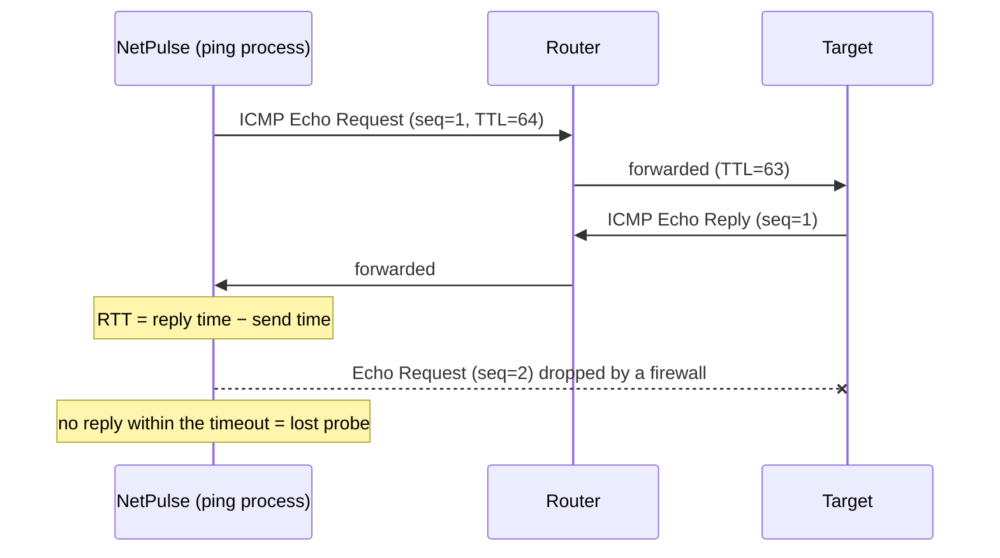

# ICMP and ping

## 1. The concept
`ping` asks one question: can an IP packet reach this host and can a reply get back? It sends **ICMP Echo Requests** and times the **Echo Replies**. From a run of probes NetPulse derives:

| Metric | Meaning | Formula |
|---|---|---|
| RTT | Round-trip time of one probe | reply time − send time |
| Packet loss | Share of probes with no reply | `(sent − received) / sent × 100` |
| Jitter | How much latency varies | mean of `abs(rtt[i] − rtt[i−1])` |

Latency hurts interactivity. Jitter hurts voice and video more than steady latency does, because playback buffers can't predict arrival times.

## 2. Layers
ICMP is carried directly inside IP (protocol number 1), so it belongs to **OSI layer 3 / the TCP/IP Internet layer**. It has **no ports**. That's why a firewall can block ping while TCP services work fine.

## 3. The protocol
| Type | Code | Name | Used for |
|---|---|---|---|
| 8 | 0 | Echo Request | The probe |
| 0 | 0 | Echo Reply | The answer |
| 3 | 0 / 1 / 3 | Destination Unreachable (net / host / port) | A router or host reporting failure |
| 11 | 0 | Time Exceeded | TTL hit 0; traceroute relies on this |

An echo message carries an **identifier** and **sequence number**, so replies can be matched to requests. IPv6 uses ICMPv6, with Echo Request 128 and Reply 129.

## 4. Flow


## 5. The Java implementation
- **Why not `InetAddress.isReachable()`?** Without raw-socket privileges the JDK silently falls back to a TCP connection on port 7. It isn't measuring ICMP and gives you no RTT or loss.
- **`PingCommandBuilder`** builds an argument list per OS. Flags really differ: the reply timeout is `-W 2` (seconds) on Linux, `-W 2000` (milliseconds) on macOS, and `-w 2000` on Windows.
- **`ProcessRunner`** uses `ProcessBuilder` with a list, so no shell ever interprets the arguments. Output is read on a separate thread to avoid a full-pipe deadlock, and a process past its timeout is killed.
- **Parsers** (`LinuxPingParser`, `MacPingParser`, `WindowsPingParser`) read every reply line, because the summary has no per-probe samples and jitter needs them.
- **Windows trap:** a router's "Destination host unreachable" counts as *Received* in the summary, so `0% loss` can be printed for a host that never answered. NetPulse counts real echo replies only.
- **Privileges:** sending raw ICMP normally needs `CAP_NET_RAW`. Linux can also allow unprivileged ICMP datagram sockets through `net.ipv4.ping_group_range`.

## 6. Verify it yourself
```bash
ping -c 4 8.8.8.8                         # compare with the device's Overview tab
sudo tcpdump -ni any icmp and host 8.8.8.8
```
Wireshark display filters: `icmp` (`icmpv6` for IPv6), `icmp.type == 8`, `icmp.type == 0`, `icmp.type == 3`. Wireshark also pairs requests with responses and shows the response time.

## 7. Troubleshooting
| Symptom | Likely cause | What to do |
|---|---|---|
| Ping fails, TCP port opens | ICMP filtered | NetPulse shows "ICMP blocked"; the host is reachable |
| `Destination Host Unreachable` from your own IP | ARP got no answer on the local subnet | Check the host is on, and the subnet |
| `Destination Net Unreachable` from a router | Missing route | Inspect that router's routing table |
| Intermittent loss | Congestion, bad cable, Wi-Fi, ICMP rate limiting | Compare with TCP behaviour before blaming the link |
| `Operation not permitted` | Missing capability | Grant `NET_RAW` or set `ping_group_range` |

## 8. Interview questions
1. **Which layer is ICMP, and does it use ports?** Layer 3, carried directly in IP (protocol 1). It has no ports; it uses type and code fields.
2. **Does a failed ping mean a host is down?** No. Firewalls often drop ICMP, and the reply path may be broken. Confirm with another check such as a TCP connect.
3. **What's the difference between Destination Unreachable and a timeout?** Unreachable is an explicit error from a device on the path. A timeout means nothing came back, so the cause is unknown.
4. **How do you calculate packet loss and jitter?** Loss is `(sent − received) / sent × 100`. Jitter here is the mean absolute difference between consecutive RTTs.
5. **Why does ping need special privileges?** Crafting ICMP traditionally requires a raw socket, which needs root or `CAP_NET_RAW`. Linux also offers unprivileged ICMP datagram sockets for allowed groups.
6. **Why is high jitter worse than high steady latency for VoIP?** A receiver can compensate for constant delay. Variable delay forces a larger jitter buffer or causes late packets to be dropped.
