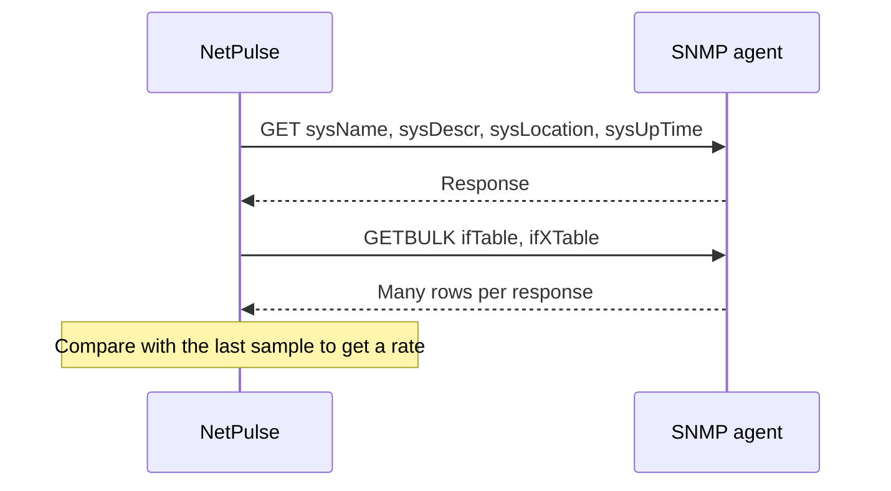

# SNMP and bandwidth monitoring

## 1. The concept

SNMP lets a manager read a device's internal state: its name, uptime, and a counter for every interface. Ping tells you a device answers. SNMP tells you how it is doing.

## 2. Layers

Application layer (OSI 7), over UDP. Agents listen on port **161**, and traps go to port 162. UDP means no connection: a lost or refused request simply gets no answer.

## 3. The protocol

Objects are named by OIDs in a tree defined by MIBs.

| Object | OID | Meaning |
|---|---|---|
| sysUpTime | 1.3.6.1.2.1.1.3.0 | Hundredths of a second since the agent started |
| ifAdminStatus | ...2.2.1.7 | What the operator configured |
| ifOperStatus | ...2.2.1.8 | What is actually happening |
| ifInOctets | ...2.2.1.10 | 32-bit received byte counter |
| ifHCInOctets | ...31.1.1.1.6 | 64-bit version |
| ifHighSpeed | ...31.1.1.1.15 | Speed in Mbit/s |

| Version | Security |
|---|---|
| v2c | A community string in clear text. A wrong one is silently ignored, so it looks like a timeout |
| v3 authPriv | HMAC authentication and AES encryption per user |

## 4. Flow



## 5. The Java implementation

`Snmp4jClient` polls with GETBULK and gives each poll its own session and USM, because SNMP4J's default USM is global.

Counters only rise, so a rate needs two samples. `CounterMath`:

```
bits/second = (current - previous) × 8 / elapsed seconds
utilization = max(in, out) / speed × 100        (full duplex: each direction has the whole line rate)
```

- **32-bit wrap:** at 1 Gbit/s, `ifInOctets` overflows in 34 seconds. If current is below previous, the delta is 2³² − previous + current. Two wraps in one interval are undetectable, which is why 64-bit counters are preferred.
- **Reboot:** `sysUpTime` went backwards, so previous counters no longer apply and that interval is discarded.
- **Elapsed time** comes from `sysUpTime`, the agent's own clock, not ours.
- A sample that can't be trusted is dropped. A gap is more honest than a false spike.

`CredentialCipher` encrypts credentials with AES-256-GCM, binding each to its device id. No API returns them.

## 6. Verify it yourself

```bash
snmpget -v2c -c public 192.168.1.1 sysUpTime.0
snmpwalk -v2c -c public 192.168.1.1 ifDescr
snmpget -v3 -u USER -l authPriv -a SHA -A AUTHPASS -x AES -X PRIVPASS 192.168.1.1 sysName.0
```

Wireshark display filter: `snmp`. On v2c the community string is readable, which is the best argument for v3. To check a rate, read `ifHCInOctets` twice, 10 seconds apart, and do the sum by hand.

## 7. Troubleshooting

| Symptom | Likely cause |
|---|---|
| Timeout on v2c | Wrong community, an ACL, or a firewall on UDP 161 |
| v3 "authentication failed" | Unknown user, or wrong passphrase |
| Rates show "—" | Needs two polls. Also blank right after a reboot |
| Rate reads 0 between bursts | Agents cache counters for a few seconds |
| Utilization above 100% | The reported speed is wrong, common on virtual interfaces |
| Interface "Admin down" | Someone ran `shutdown`. NetPulse doesn't alert on that |

## 8. Interview questions

1. **Why does SNMP use UDP?** Polling is small and frequent, and the manager retries, so connection overhead isn't worthwhile.
2. **Difference between ifAdminStatus and ifOperStatus?** Admin is the configured intent. Oper is the actual state. Admin up with oper down is a fault.
3. **How do you compute bandwidth from counters?** Take the difference between two samples, multiply by 8, and divide by the seconds between them.
4. **How do you handle counter wrap?** Prefer 64-bit HC counters. For 32-bit, add 2³² when the value decreased, unless a reboot explains it.
5. **Why is sysUpTime needed?** To detect reboots, and to measure the interval on the agent's own clock.
6. **Compare v2c and v3.** v2c sends a clear-text community string. v3 adds per-user authentication and encryption.
7. **GETNEXT or GETBULK?** GETBULK returns many rows per request, which saves round trips on large tables.
8. **Polling or traps?** Polling gives regular data. Traps give fast notice but run over UDP and can be lost, so most systems use both.
