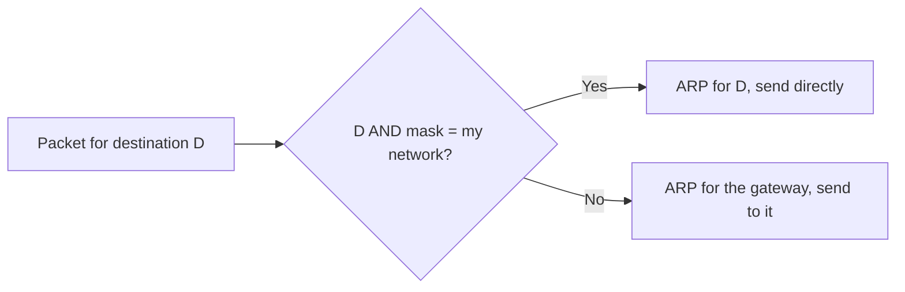

# Subnetting, CIDR and VLSM

## 1. The concept

An IPv4 address is a 32-bit number. A prefix length says how many leading bits identify the network and how many are left for hosts. Subnetting lends host bits to the network so one block can be split into smaller ones.

## 2. Layers

Layer 3 (Network) in OSI, Internet in TCP/IP. A host uses its mask to decide one thing: is this destination on my link, or do I send it to my gateway?

## 3. The maths

For `192.168.10.77/26`:

| Value | Operation | Result |
|---|---|---|
| Mask | 26 ones, then zeros | `255.255.255.192` |
| Wildcard | NOT mask | `0.0.0.63` |
| Network | IP AND mask | `192.168.10.64` |
| Broadcast | Network OR wildcard | `192.168.10.127` |
| Usable hosts | 2^(32−26) − 2 | 62 |

The exceptions are **/31**, where RFC 3021 makes both addresses usable on a point-to-point link, and **/32**, a single host.

**Classful addressing (A, B, C) has been obsolete since CIDR in 1993.** NetPulse shows the class only as a labelled historical note.

Special ranges to know: `10.0.0.0/8`, `172.16.0.0/12` and `192.168.0.0/16` (private, RFC 1918), `127.0.0.0/8` (loopback), `169.254.0.0/16` (link-local), `100.64.0.0/10` (carrier NAT), `224.0.0.0/4` (multicast).

## 4. Flow: how a host uses the mask



**VLSM** gives each segment only the size it needs. Allocate largest first: every block starts on a multiple of its own size, so descending order keeps the next free address aligned and leaves no gaps.

| Segment | Hosts | Needs | Subnet |
|---|---|---|---|
| Sales | 50 | /26 (62) | 192.168.1.0/26 |
| IT | 20 | /27 (30) | 192.168.1.64/27 |
| HR | 10 | /28 (14) | 192.168.1.96/28 |
| WAN | 2 | /30 (2) | 192.168.1.112/30 |

## 5. The Java implementation

`SubnetCalculator` is pure arithmetic with no library. Addresses are stored in a `long` because Java has no unsigned `int`, and a value like `192.x.x.x` would otherwise be negative. `vlsm()` sizes each block with network and broadcast reserved, sorts largest first, and reports exactly which segment didn't fit. It handles IPv4 only. `SubnetCalculatorTest` holds the CCNA-style cases.

## 6. Verify it yourself

```bash
ipcalc 192.168.10.77/26              # Linux; on macOS: brew install ipcalc
ip addr show                         # your prefix on Linux
ifconfig en0                         # macOS shows the mask in hex
```

In Wireshark there is no field for the mask: it is never sent in ordinary traffic. Filter on a range with `ip.addr == 192.168.10.64/26`. On a Cisco router, `show ip route connected` lists your subnets.

## 7. Troubleshooting

| Symptom | Likely cause |
|---|---|
| Can reach the local subnet, nothing else | Wrong or missing default gateway |
| Two hosts can reach one another in only one direction | Mismatched masks: each disagrees about who is local |
| "Overlapping address" on a router | Two interfaces were given intersecting subnets |
| Address starts with 169.254 | DHCP failed and the host picked a link-local address |

## 8. Interview questions

1. **How many usable hosts are in a /27?** 30: 2^5 − 2.
2. **Find the network for 172.16.35.123/20.** The mask's third octet is 240, so the block size there is 16. 35 falls in the block starting at 32, giving `172.16.32.0`, with broadcast `172.16.47.255`.
3. **Why subtract 2?** The all-zeros host address names the network and the all-ones address is broadcast.
4. **When is a /31 used?** On point-to-point links, where no broadcast is needed, which saves addresses.
5. **Why allocate VLSM largest first?** Each block must align to its own size, and descending order keeps every next block aligned with no wasted gaps.
6. **What is a wildcard mask used for?** Cisco ACLs and OSPF network statements. It is the inverse of the subnet mask.
7. **What did CIDR replace, and why?** Classful addressing, which wasted space with fixed sizes and bloated routing tables that CIDR can aggregate.
