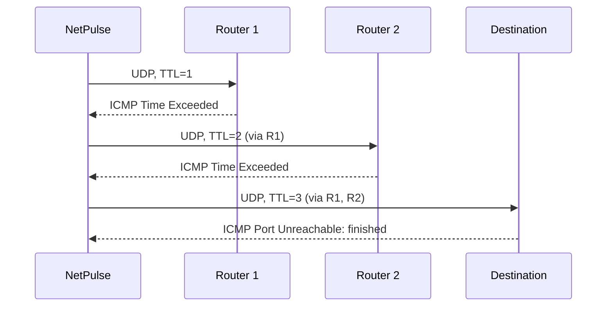

# Traceroute and TTL

## 1. The concept

Traceroute finds the routers between you and a destination. No protocol reports a path, so the tool provokes each router into identifying itself by making a packet expire at it.

## 2. Layers

| OSI | TCP/IP | Role here |
|---|---|---|
| 3 Network | Internet | The IP TTL field, and ICMP errors |
| 4 Transport | Transport | The UDP probe (Linux and macOS default), which the destination rejects |

## 3. The protocol

Every IP packet has a TTL (Hop Limit in IPv6). Each router subtracts 1, and the router that reaches 0 drops the packet and returns **ICMP Time Exceeded** (type 11, code 0). TTL exists so that a routing loop can't circulate a packet forever.

| Tool | Probe | How the destination ends the trace |
|---|---|---|
| Linux, macOS `traceroute` | UDP to a high port, about 33434 | ICMP Port Unreachable (type 3, code 3) |
| Windows `tracert` | ICMP Echo Request | ICMP Echo Reply |

## 4. Packet flow



## 5. The Java implementation

- `TracerouteCommandBuilder` builds the argument list from a validated `InetAddress`, so user text never reaches the command line.
- `ProcessRunner.runStreaming` hands over each output line as it is printed. Linux gets `-N 1`, because by default it sends 16 probes at once and hops would arrive in a batch.
- `UnixTracerouteParser` and `WindowsTracerouteParser` turn a line into a `TracerouteHop`. The Windows parser matches structure because `tracert` output is translated.
- `TracerouteService` publishes each hop to `/topic/traceroute/{id}`, and stops after 5 consecutive silent hops. The UI also polls the run, so hops sent before it subscribed aren't lost.

## 6. Verify it yourself

```bash
traceroute -n 8.8.8.8        # Linux or macOS
tracert 8.8.8.8              # Windows
mtr -rwc 20 8.8.8.8          # loss and latency per hop, on Linux
```

Wireshark display filter: `icmp.type == 11 || icmp.type == 3`. Sort by time and watch the IP TTL field rise from 1.

## 7. Troubleshooting

| You see | Likely meaning |
|---|---|
| `* * *` on one hop, later hops answer | That router rate-limits or ignores probes. The path is fine |
| `* * *` until the end | A firewall drops the probes or their replies. Try `traceroute -I` (ICMP) or `-T -p 443` (TCP) |
| High RTT at one hop only | The router answers slowly from its control plane. Only a rise that **continues** to later hops is real delay |
| Two IPs at one hop | Load balancing (ECMP) sent probes down different paths |
| `!H`, `!N`, `!X` | Host unreachable, network unreachable, administratively prohibited |
| A repeating pair of IPs | A routing loop |
| Only one hop under Docker Desktop | The container sits behind the VM's NAT |

## 8. Interview questions

1. **How does traceroute work?** It sends probes with TTL 1, 2, 3 and so on. Each router that decrements TTL to 0 returns ICMP Time Exceeded, revealing its address. The destination replies differently, which ends the trace.
2. **Why does traceroute send three probes per hop?** To show variation and to survive a lost packet. Each probe can also take a different path under load balancing.
3. **Does a `*` mean the hop is down?** No. It means no reply arrived in time. If later hops answer, packets are clearly passing through it.
4. **Latency jumps at hop 5 but is low at hops 6 onward. Is there a problem?** No. The router is slow to generate ICMP, but it forwards traffic normally in hardware.
5. **Why can the forward path differ from what you see?** Traceroute shows only the forward path, while the RTT also includes the return path, which may be different (asymmetric routing).
6. **What is the difference between Linux and Windows traceroute?** Linux uses UDP probes by default and Windows uses ICMP Echo, so a firewall can treat them differently.
7. **Why does traceroute need raw socket privileges?** Reading ICMP errors usually needs a raw socket, hence `NET_RAW` in the container.
